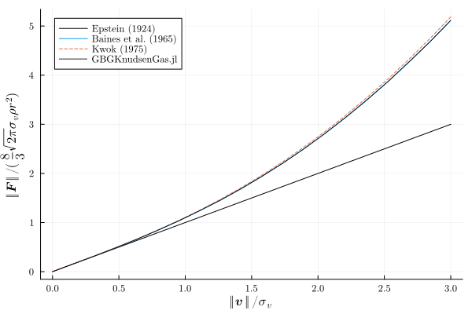

# Example: Epstein drag calculation

We provide a concrete and complete example of how to use `GBGKnudsenGas.jl` to build your own flow setup using Epstein drag calculation as an example. If one is simply interested in calculating the forces and torques acting on a body in a uniform flow of equilibrium Knudsen gas, one should just use [`force_and_torque_uniform_flow`](@ref).

## Epstein drag

Consider stationary flow of a Knudsen gas past a sphere with the collisions following the [Maxwell law.](https://doi.org/10.1146/annurev-fluid-121021-014808) The gas is at thermal equilibrium, with unperturbed (at infinity) temperature $T$, density $\rho$, and mean velocity $\langle \boldsymbol v_0 \rangle$. Angle brackets $\langle {\cdot} \rangle$ denote ensemble averages, and primes ${\cdot}'$ denote the corresponding fluctuations. Before colliding with the body, the initial particle velocity $ \boldsymbol v_0$ follows the Maxwell–Boltzmann probability density function

```math
f(\boldsymbol v_0) = \frac{1}{(\sqrt{2 \pi \sigma_v^2})^3} \exp \biggl[- \frac{(\boldsymbol v_0 - \langle \boldsymbol v_0 \rangle) \cdot (\boldsymbol v_0 - \langle \boldsymbol v_0 \rangle)}{2 \sigma_v^2}\biggr],
```
where

```math
\sigma_v = \sqrt{\frac{k_\text{B} T}{m}},
```
and $m$ is the mass of a single particle. The speed of sound $c$ in the gas is defined through the adiabatic index $\gamma$:

```math
c = \sqrt{\gamma \frac{k_\text{B} T}{m}} = \sqrt \gamma \sigma_v.
```
For a monatomic gas $\gamma = 5/3$. The Mach number $\text{Ma}$ is

```math
\text{Ma} = \frac{\| \langle \boldsymbol v_0 \rangle \|}{c} = \frac{\| \langle \boldsymbol v_0 \rangle \|}{\sigma_v \sqrt \gamma}.
```
The Maxwell reflection law is charecterized by the diffuse fraction $\alpha$ and wall thermal velocity scale $\sigma_{v_\text{wall}}$, so that one can model
- purely specular reflections ($\alpha = 0$),
- purely diffuse reflections ($\alpha = 1$),
- Bernoulli mixture of specular and diffuse reflections ($0 < \alpha < 1$).

A gas particle that reflects diffusely has an outgoing velocity $\boldsymbol v$ distributed according to the following probability density function, where $\boldsymbol n$ denotes the outward wall normal:

```math
f_\text{diff}(\boldsymbol v) = \left\{
\begin{aligned}
  &\frac{\boldsymbol v \cdot \boldsymbol n}{2 \pi \sigma_{v_\text{wall}}^4} \exp \biggl(- \frac{\boldsymbol v \cdot \boldsymbol v}{2 \sigma_{v_\text{wall}}^2} \biggr) && \text{if\ }\boldsymbol v \cdot \boldsymbol n > 0,\\
  & 0 && \text{otherwise.}
\end{aligned}\right.
```

Let $\boldsymbol F$ be the force that the flowing gas exerts on the sphere and $r$ be the radius of the sphere. In the limit of small Mach numbers, $\text{Ma} \ll 1$, the Epstein (1924) expression for $F_\text{drag}$ is

```math
\boldsymbol F_\text{Epstein (1924)}
= \biggl(1 + \frac{\pi}{8} \alpha \frac{\sigma_{v_\text{wall}}}{\sigma_v} \biggr) \frac{8}{3} \sqrt{2 \pi} \sigma_v \rho r^2 \langle \boldsymbol v_0 \rangle,
```

see the papers

* Epstein, Paul S. (1924). "On the resistance experienced by spheres in their motion through gases." _Physical Review,_ 23(6), 710, [10.1103/PhysRev.23.710](https://doi.org/10.1103/PhysRev.23.710).
* Li, Zhigang, and Wang, Hai (2003). "Drag force, diffusion coefficient, and electric mobility of small particles. I. Theory applicable to the free-molecule regime." _Physical Review E,_ 68(6), 061206, [10.1103/PhysRevE.68.061206](https://doi.org/10.1103/PhysRevE.68.061206).

For arbitrary Mach numbers, the exact formula for $\boldsymbol F$ was derived by Baines et al. (1965):

```math
\begin{aligned}
\boldsymbol F_\text{Baines et al. (1965)} &=
\frac{\boldsymbol F_\text{Epstein (1924)}}{1 + \frac{\pi}{8} \alpha \frac{\sigma_{v_\text{wall}}}{\sigma_v}} \\
\times \biggl\{ \frac{3}{8} \psi \biggl[\biggl( & \frac{1}{\psi} + \frac{1}{2 \psi^3} \biggr) \exp(- \psi^2) + \biggl(1 + \frac{1}{\psi^2} - \frac{1}{4 \psi^4} \biggr) \sqrt \pi \operatorname{erf}{\psi} \biggr] + \frac{\pi}{8} \alpha \frac{\sigma_{v_\text{wall}}}{\sigma_v} \biggr\},
\end{aligned}
```
with $\psi = \frac{\| \langle \boldsymbol v_0 \rangle \|}{\sqrt 2 \sigma_v}$, see the original paper
* Baines, M. J., Williams, I. P., Asebiomo, A. S., & Agacy, R. L. (1965). "Resistance to the motion of a small sphere moving through a gas." _Monthly Notices of the Royal Astronomical Society,_ 130(1), 63, [10.1093/mnras/130.1.63](https://doi.org/10.1093/mnras/130.1.63).

Later, a good approximation for $F_\text{drag}$ was given by Kwok (1975), for specular collisions:

```math
\boldsymbol F_\text{Kwok (1975)} = \sqrt{1 + \frac{9\pi}{128} \biggr( \frac{\| \langle \boldsymbol v_0 \rangle \|}{\sigma_v} \biggr)^{\!2} } \, \boldsymbol F_\text{Epstein (1924)},
```

see the papers
* Laibe, Guillaume, and Price, Daniel J. (2012). "Dusty gas with smoothed particle hydrodynamics–II. Implicit timestepping and astrophysical drag regimes." _Monthly Notices of the Royal Astronomical Society,_ 420(3), 2365, [10.1111/j.1365-2966.2011.20201.x](https://doi.org/10.1111/j.1365-2966.2011.20201.x)
* Kwok, Sun (1975). "Radiation pressure on grains as a mechanism for mass loss in red giants." _Astrophysical Journal,_ 198(6??), 583, [10.1086/153637](https://doi.org/10.1086/153637).


## Monte Carlo calculation of Epstein drag with `GBGKnudsenGas.jl`

The full code of this computation is available in `examples/epstein_drag.jl`. That's a conceptual outline of using `GBGKnudsenGas.jl` for custom flow setups. For a more advance code for simulating the same flow see the source of [`force_and_torque_uniform_flow`](@ref) as well as our [development tips.](development.md) For simplicity, below we study only specular collisions, $\alpha = 0$.

### Computing $\boldsymbol F$

We start by defining our sphere, `epstein_sphere`, with radius $1.0$ and center at the origin $(0, 0, 0)$ of the Cartesian coordinate system:

```julia
using StaticArrays
using GBGKnudsenGas

epstein_sphere = Sphere(SA[0.0, 0.0, 0.0], 1.0)
```

The calculation of $\boldsymbol F$ is based on the statistics of the velocity increments of the gas particles. Let $\boldsymbol v_\infty(\boldsymbol v_0, \boldsymbol x_0)$ be the final velocity of a gas particle that initially had velocity $\boldsymbol v_0$ and position $\boldsymbol x_0$. The velocity increment is

```math
\Delta \boldsymbol v(\boldsymbol v_0, \boldsymbol x_0) = \boldsymbol v_\infty - \boldsymbol v_0
```
Recall from the [introduction,](index.md) that

```math
\boldsymbol F = - \rho  \pi r_\text{dom}^2 \bigl< \| \boldsymbol v_0 \| \Delta \boldsymbol v(\boldsymbol v_0, \boldsymbol x_0) \bigr>.
```

The ensemble average is taken over particles whose initial states ($\boldsymbol v_0$ and $\boldsymbol x_0$) are sampled using [`sample_particle_state_uniform_flow`](@ref). Let $P(\text{hit})$ denote the probability that a particle collides with the body. Then we can rewrite the expression for $|\boldsymbol F|$ using the average conditioned on a collision:

```math
\boldsymbol F = - \rho  \pi r_\text{dom}^2 P(\text{hit}) \bigl< \| \boldsymbol v_0 \| \Delta \boldsymbol v(\boldsymbol v_0, \boldsymbol x_0) \bigm| \text{hit} \bigr> .
```

To evaluate this conditional average, we first define a helper function `find_single_collision`, which repeatedly draws particles from the initial distribution until one collides with the body. It accepts the following arguments:

- the body (`body`),
- the mean velocity $\langle \boldsymbol v_0 \rangle$ (`mean_v`),
- the velocity standard deviation $\sigma_v$ (`std_v`),
- the simulation domain radius $r_\text{dom}$ (`domain_radius`), see the [introduction.](index.md)

We later call this function with `epstein_sphere` as the body and $r_\text{dom} = 2$.

The function returns the particle’s initial state (`particle_before`), its state after the collision (`particle_after`), and the number of non-colliding samples encountered before a hit was found (`missed_particles_number`):

```julia
function find_single_collision(body, mean_v, std_v, domain_radius)
  missed_particles_number = 0
  
  while true
    particle_before = sample_particle_state_uniform_flow(mean_v, std_v, domain_radius)
    particle_after  = collide_with_body(particle_before, body)
    
    if !isnothing(particle_after)
      return particle_before, particle_after, missed_particles_number
    end
    
    missed_particles_number += 1
  end 
end
```

Next, we present the function `force_MC`, which computes $\boldsymbol F$. In addition to the arguments accepted by `sample_particle_state_uniform_flow`, it accepts `sample_size`, the number of particles that actually collide with the body and thus determine the accuracy of the Monte Carlo estimator:

```julia
using LinearAlgebra

function force_MC(body, mean_v, std_v, domain_radius, sample_size)
  T = eltype(mean_v)
  F_sum = SVector{3, T}(0, 0, 0)
  missed_sum = zero(Int)

  for i in 1:sample_size
    p_b, p_a, missed = find_single_collision(body, mean_v, std_v, domain_radius)
    F_sum += norm(p_b.v) * (p_a.v - p_b.v)
    missed_sum += missed
  end

  collision_probability = sample_size / (sample_size + missed_sum)
  force = - F_sum / sample_size * collision_probability * π * domain_radius^2

  return force
end
```

We now call `force_MC` for our `epstein_sphere` and for 20 different values of $\| \langle \boldsymbol v_0 \rangle \|$. We then plot the results together with the analytical predictions of Epstein (1924), Baines et al. (1965), and Kwok (1975):

```julia
using SpecialFunctions
using Plots
using LaTeXStrings

pgfplotsx()

for command in ["\\usepackage{amsmath}"]
  if command ∉ PGFPlotsX.CUSTOM_PREAMBLE
    push!(PGFPlotsX.CUSTOM_PREAMBLE, command)
  end
end

epstein_sphere = Sphere(SA[0.0, 0.0, 0.0], 1.0)

const σ_v   = 1.0
const r_dom = 2.0

mean_v_values = [SA[mean_v, 0.0, 0.0] for mean_v in range(0.0, 3.0, 20)]
force_MC_values = force_MC.(Ref(epstein_sphere), mean_v_values, σ_v, r_dom, 10^6)

force_Epstein(mean_v, std_v) = 8/3 * √(2 * π) * std_v * epstein_sphere.r^2 * mean_v

function force_Baines(mean_v, std_v)
  ψ = norm(mean_v) / (√2 * std_v)
  return 3/8 * ψ * ((1/ψ + 1/(2ψ^3)) * exp(-ψ^2) + (1 + 1/ψ^2 - 1/(4ψ^4)) * √π * erf(ψ)) * force_Epstein(mean_v, std_v)
end

force_Kwok(mean_v, std_v) = force_Epstein(mean_v, std_v) * √(1 + 9 * π / 128 * (norm(mean_v) / std_v)^2)


normalize_force(F) = norm(F) / (8/3 * √(2 * π) * σ_v * epstein_sphere.r^2)

plot(
  norm.(mean_v_values) / σ_v,
  [
    normalize_force.(force_Epstein.(mean_v_values, σ_v)),
    normalize_force.(force_Baines.(mean_v_values, σ_v)),
    normalize_force.(force_Kwok.(mean_v_values, σ_v)),
    normalize_force.(force_MC_values)
  ],
  label = ["Epstein (1924)" "Baines et al. (1965)" "Kwok (1975)" "GBGKnudsenGas.jl"], legend = :topleft,
  color = [:black 1 2 :black], linestyle = [:solid :solid :dash :dash],
  ylabel = L"\| \boldsymbol{F} \| \bigm/ (\frac{8}{3} \sqrt{2 \pi} \sigma_v \rho r^2)",
  xlabel = L"\| \langle \boldsymbol v_0 \rangle \| / \sigma_v", xticks = 0:0.5:3
)

display(plot!())

savefig("Epstein_drag.svg")
```



As we see, `GBGKnudsenGas.jl` reproduces the exact formula of Baines et al. (1965) with excellent accuracy.

### Computing force linear response tensor

In the low Mach number regime, $\text{Ma} \ll 1$, the force $\boldsymbol F$ is linear in $\langle \boldsymbol v_0 \rangle$ and is fully described by the linear response tensor $\mathrm d \boldsymbol F / \mathrm d \langle \boldsymbol v_0 \rangle$:

```math
\boldsymbol F
= \frac{\mathrm d \boldsymbol F}{\mathrm d \langle \boldsymbol v_0 \rangle} \bigg|_{\langle \boldsymbol v_0 \rangle = 0} \cdot \langle \boldsymbol v_0 \rangle + \ldots.
```

For our sphere

```math
\frac{\mathrm d \boldsymbol F}{\mathrm d \langle \boldsymbol v_0 \rangle} \bigg|_{\langle \boldsymbol v_0 \rangle = 0}
= \frac{8}{3} \sqrt{2 \pi} \sigma_v \rho r^2 \, \mathbf{I},
```

where $\mathbf{I}$ is the identity tensor.

To compute $\mathrm d \boldsymbol F / \mathrm d \langle \boldsymbol v_0 \rangle$ at $\langle \boldsymbol v_0 \rangle = 0$ with `GBGKnudsenGas.jl` we use Julia's capabilities in differential programming:

```julia
using ForwardDiff

force_linear_response_MC = ForwardDiff.jacobian(mean_v -> force_MC(epstein_sphere, mean_v, σ_v, r_dom, 10^7), SA[0.0, 0.0, 0.0])

epstein_coefficient = 8/3 * √(2 * π) * σ_v * epstein_sphere.r^2

println("\n(dF / dv) / epstein_coefficient = ")
display(round.(force_linear_response_MC / epstein_coefficient, digits = 5))
```

which produces

```console
(dF / dv) / epstein_coefficient = 
3×3 SMatrix{3, 3, Float64, 9} with indices SOneTo(3)×SOneTo(3):
  1.00022   0.00063  -8.0e-5
  0.00014   1.00011  -2.0e-5
 -7.0e-5   -0.00026   1.00039
```

Note that automatic differentiation is inherently inaccurate when computing Jacobians for complex compound bodies. However, it works for a single sphere, as shown above.